| Demo | Made with | What happens |
|---|---|---|
| [**magpie-season**](https://github.com/GlitchGlam/magpie-season) ([live](https://glitchglam.github.io/magpie-season/)) | JavaScript, CSS, WebGL | A magpie flies over your text and flags over-claim words. |
| [**off-the-rails**](https://github.com/GlitchGlam/off-the-rails) | Ruby | A terminal train keeps breaking down. Fix the code to get it moving. |

<b>How was this banner made?</b>

 

One SVG file and CSS, generated by `tools/make_banner.py`. No JavaScript, and nothing loads from another
website.

- **The flight** is a CSS `offset-path` with a loop drawn into the path itself. The bird turns to follow
  the path (`offset-rotate: auto`), so it rolls through the loop nose first.
- **The flap** morphs the wing between three shapes with the CSS `d` property, with the feather fan
  computed by rotating the feather tips about the shoulder. Browsers without `d` keep a banking wing.
- **The afterimages** are the same bird drawn through `<use>`, started a fraction of a second later and
  fading. **The sparkle trail** is fourteen dots on the same path, each a little further behind.
- **The glitch** is three copies of the word. The cyan and pink ones sit exactly behind the real one and
  tear sideways, sliced with `clip-path: inset()`, timed to the moment the bird loops over the letters.
- **The shimmer** cycles the wing's gradient stops through purple, blue and green.
- **The glow** is an SVG `feGaussianBlur` under the text. **The scanlines** are a tiny repeating pattern,
  and the sweep is a gradient moving down.
- **Motion is optional.** Every animation sits inside `@media (prefers-reduced-motion: no-preference)`,
  so if your device asks for less motion the bird rests on its path and the title stays still.

